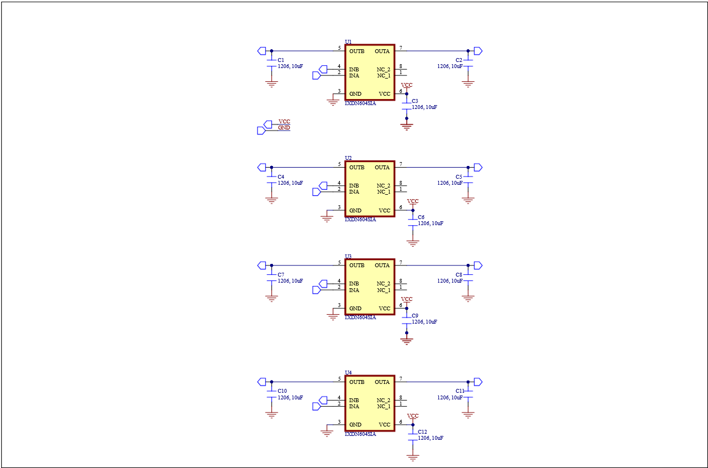

# IXDN602 Dual Gate Driver

A dual-channel, high-speed MOSFET gate driver circuit based on the **IXDN602**, designed for power electronics applications.

## Overview

This project features a gate driver circuit designed around the IXDN602 high-speed dual-channel driver IC. The design focuses on reliable signal driving, fast switching performance, and proper supply decoupling.

## Schematic

## Features

- IXDN602 dual-channel gate driver
- High-speed switching capability
- Independent INA and INB inputs
- OUTA and OUTB gate drive outputs
- Local supply decoupling capacitors
- Compact circuit design
- Designed for power electronics applications

## Hardware

| Component | Description |
|---|---|
| IXDN602 | Dual-channel high-speed gate driver |
| C1–C12 | 10 µF capacitors |
| PCB | Custom-designed printed circuit board |

## Applications

- MOSFET gate driving
- DC-DC converters
- Motor control systems
- Power inverters
- Switching power supplies
- High-frequency power electronics

## Disclaimer

This project is intended for educational, experimental, and development purposes. Verify electrical ratings, PCB layout, thermal performance, and circuit operation before practical use.

## License

To be determined.

---

Designed for power electronics development.